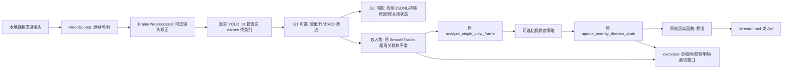

# 项目结构与调用关系

文件作用：供新开发者了解真实仓库结构与模块数据流。修改入口、接口、数据位置或依赖后更新；先读本文件，再按 NEWCOMER_HANDOFF.md 运行。这里只列实际检出的内容，建议结构会明确标注未实现。

## 来源与工作区

用户指定上游：https://github.com/zzzokay/camera_150_with_face 。基线提交 `5bd9c5a437536706f51106a5e86fbb2a7ec46906`，当前分支 `g1/person-detection-ball-slot`；G0 提交保留在历史中。
开始时本目录没有 `.git` 或工程源码，只有两份规范与 `best_sac/`；现已建立 Git 并从上游取得应用源码。
使用 **稀疏检出（sparse checkout：只把所需文件放到工作目录）**，49 个上游应用文件被检出。
上游的 Linux 虚拟环境、人脸档案、运行状态、模型等仍在上游版本树中，未删除、未主动检出；本轮未重新提交这些资产。
检出规则位于本机 `.git/info/sparse-checkout`，不是跨机器配置；全新 clone 具有完整上游树，Windows 入口不依赖被排除资产。

## 当前真实树

```text
project/
├── .git/                                 本地版本、分支及稀疏检出规则
├── AGENT_DEVELOPMENT_RULES.md             用户提供的工程规范（保留）
├── STAGE1_WINDOWS_TO_TCN_PLAN.md          用户提供的关卡合同（保留）
├── README.md / PROJECT_STRUCTURE.md / NEWCOMER_HANDOFF.md
├── STAGE_PROGRESS.md / CHANGELOG.md
├── requirements-windows.txt              G0 直接依赖
├── requirements-windows.lock.txt         已生成：最终实测 CPU 环境完整 39 包版本
├── pytest.ini / .gitignore
├── run_windows.py                        可用绝对路径从任意工作目录启动
├── check_windows_environment.py          环境/模型目录清单，不反序列化模型
├── check_windows_camera.py               相机打开/收帧时间/可选窗口检查，不保存画面
├── configs/windows.example.yaml          可复制的相对路径配置
├── camera_150/
│   ├── camera_movement_modified/          原 RK3588 入口与规则
│   │   ├── single_rknn_base.py            延迟导入 RKNN；其余算法不变
│   │   ├── predict1_weighted.py           原分析算法，未修改
│   │   ├── predict1_director.py           支持包导入，调试绘图依赖延迟
│   │   ├── single_rknn_director_view720_network_stream.py  未修改
│   │   ├── single_rknn_director_view720_record_local.py    未修改
│   │   ├── single_rknn_director_view1920_record_local.py   未修改
│   │   ├── director_game_policy.py / audio_chain.py       未修改
│   ├── windows_pipeline/                 G0/G1，未加入 ByteTrack/训练
│   │   ├── config.py / contracts.py / sources.py / preprocessing.py
│   │   ├── detector.py / director_adapter.py / rendering.py
│   │   ├── detection_policy.py / detection_records.py   G1 策略/检测审计
│   │   └── outputs.py / run.py / diagnostics.py
│   ├── techtable_v2/                      原技术台应用源码，未修改
│   ├── face_checkin_lbph*.py              原检录应用源码，未修改
│   ├── model/labels.txt                   原标签 person
│   ├── camera_usb3_calib.npz              原镜头标定，非球场映射
│   ├── camera150_techtable_v3_patch/       原补丁工具源码，未执行
│   └── start_all_techtable.py / stop_all_techtable.py 等原管理脚本
├── windows_camera_150_client/             原 Windows RTSP 客户端源码，未修改
├── configs/detection*.example.yaml        G1 通用/本次室内策略，篮球默认关闭
├── configs/g1.indoor.example.yaml         G1 运行模板，本地副本被忽略
├── tests/                                G0/G1 组件/回归/真实模型测试
├── docs/                                 G0/G1 报告、平台矩阵、G1 检测 schema
├── best_sac/                              用户原文件，Git 忽略，未加载
├── video/                                 用户补充的室内比赛录屏，MP4 被 Git 忽略
├── .venv/                                本机独立 Python 环境，Git 忽略
└── runs/                                 本机输出与证据，Git 忽略
```

`data/`、`models/` 是推荐的用户数据位置，示例引用它们，但代码不要求预先创建这些目录。
`research/`、`tracker.py`（ByteTrack）、`tracking.yaml`、`feature_schema.yaml`、`tcn.yaml` **尚未创建/实施**。

## 原 RK3588 管线

`start_all_techtable.py` 管理检录、导播和技术台进程；`face_checkin_lbph_stable.py` 负责 LBPH 人脸身份检录。
`single_rknn_director_view720_network_stream.run()` 采集 Linux 摄像头、按原标定去畸变、执行 RKNN，复用规则后经 FFmpeg 推流。
它也可读取 `director_game_policy.GameStateReader` 提供的技术台状态，在暂停/罚球时影响规则。
`techtable_v2/state_store.py` 与 `rk_techtable_panel.py` 管理比赛状态和 UI；`windows_camera_150_client` 接收 RTSP 并显示状态。
这些功能与本轮本地视频入口并存，设备与端到端网络未在本轮验证。

## Windows 数据流



本轮没有 ByteTrack、训练数据导出、特征和神经导播策略。G1 只增加检测审计，球按用户要求关闭。
每 `detect_interval` 帧进行一次真实检测，中间帧沿用上一轮观测，并像旧入口一样更新平滑与规则状态。
`overview` 明示 `NEW INFERENCE` / `REUSED age=N source frames`；不能用这些复用框直接计算运动真值。

## 文件接口表

| 路径（相对项目根） | 主要入口 | 输入 → 输出 / 被谁调用 |
|---|---|---|
| `run_windows.py` | `main` 转发 | CLI → 退出码；用户调用 |
| `camera_150/windows_pipeline/config.py` | `RunConfig`, `load_config` | YAML/CLI → 绝对路径与校验后的参数；run 调用 |
| `camera_150/windows_pipeline/contracts.py` | `VideoFrame`, `Detection` | 内存类型，字段见下；source/detector 调用 |
| `camera_150/windows_pipeline/sources.py` | `VideoSource.read` | 文件/设备 → 顺序帧、源索引、秒；run 调用 |
| `camera_150/windows_pipeline/preprocessing.py` | `FramePreprocessor.apply` | 原 BGR → 全幅 BGR；尺寸不符报错 |
| `camera_150/windows_pipeline/detector.py` | `YoloDetector.detect` / G0 兼容 `YoloPersonDetector` | 本地 `.pt` + 全幅 BGR → 真实标准类别框及排除原因；不调用 model.track |
| `camera_150/windows_pipeline/detection_policy.py` | `load_detection_policy`, `resolve_class_ids`, `rejection_reason` | YAML/真实 names/像素框 → 标准类及筛选依据；ball 默认关闭 |
| `camera_150/windows_pipeline/detection_records.py` | `DetectionRecords.write` | 每帧真实观测/无观测状态 → g1_detections_v1 JSONL；不是轨迹表 |
| `camera_150/windows_pipeline/director_adapter.py` | `LegacyDirector.process` | 人物框 → 原平滑/规则 → 裁切图与状态 |
| `camera_150/windows_pipeline/rendering.py` | `render_sample_director_view720` | 原录制脚本四个纯函数的独立副本；测试约束一致性 |
| `camera_150/windows_pipeline/outputs.py` | `SavedVideo`, `verify_video` | BGR → 视频；关闭后逐帧解码核验 |
| `camera_150/windows_pipeline/run.py` | `run_pipeline` | 配置 → 唯一目录和运行报告；异常写失败状态 |
| `camera_150/windows_pipeline/diagnostics.py` | `collect_environment` | 本机环境/文件名 → JSON；不加载检查点 |
| `camera_150/camera_movement_modified/single_rknn_base.py` | `WideDetection`, `SmoothTracks`, `PersonDetector` | 原 RKNN/通用边界；Windows 只用通用能力 |
| `camera_150/camera_movement_modified/predict1_weighted.py` | `analyze_single_view_frame` | 原 boxes_info → 主战区/横向热点 |
| `camera_150/camera_movement_modified/predict1_director.py` | `update_overlay_director_state` | 热点 + 历史状态 → 窗口/裁切状态 |
| `tests/test_real_model.py` | `test_actual_yolo_video_to_original_director` | 环境变量指定真实文件 → 实际 YOLO 与两路视频 |

保留纯函数副本的原因：原录制模块在 import 时同时引入音频、脚本路径和旧绘图兜底；复制四个短纯函数可避免启动这些依赖，未复制整个 1000 行入口。回归测试逐一比较 AST（抽象语法树，即代码结构），修改原渲染算法时必须同步副本和测试，不能静默分叉。

## 数据约定与存放

- `VideoFrame`：`image_bgr` 为 `[H,W,3]` uint8，`source_frame_idx` 从 0 起，`timestamp_sec` 为秒；容器 PTS 无效时用 `idx/fps` 并计数。摄像头使用 `perf_counter` 高精度单调时钟，表示收帧时刻，不等于相机曝光 PTS。
- `Detection`：标准 `class_name=person/ball`，保留真实 `model_class_id`、`confidence`、`bbox_xyxy` 全幅像素、`coord_system`、`observed=true`。本轮模型只实际产出 person；复用框在内存 observed=false，JSONL 不复制成新观测。
- 坐标空间：`none` 是 `raw_full_frame_px`；`already/calibration` 是 `undistorted_full_frame_px`。`already` 是用户声明，本轮不重新标定验证镜头模型。
- `summary.json`：版本 `g0_run_v1`，含真实模型类别/哈希、参数、源属性、推理耗时、真实观测次数、复用帧数、首条真实框、最终裁切框及产物解码统计。它是运行审计报告，**不是 G3 轨迹数据集**。
- G1 开启策略或检测导出后，目录前缀为 g1，报告为 `g1_run_v1`，增加完整策略与按类计数；`detections.jsonl` 为 `g1_detections_v1`，每处理帧一行，含真实/复用标记、框/排除原因、球 valid/status。球关闭为 false/null。精确定义见 [G1_DETECTION_SCHEMA.md](docs/G1_DETECTION_SCHEMA.md)。
- `configs/detection.indoor.example.yaml` 当前人物 ROI 为全宽、y 比例 0.66–0.97，按框底部中心筛选；本次仅将上边界由 0.70 提高到 0.66，不改数据格式或算法。新旧同片段结果见 [G1 最新补充验收](docs/G1_ACCEPTANCE_REPORT.md)，证据在各自 runs 目录，旧产物不覆盖。
- 片段选择：`start_seconds` 默认 0；顺序解码至首个 `timestamp_sec >= start_seconds` 的帧才开始推理/规则处理/保存，不重新压缩输入。保留原帧号/时间，片段第一帧立即推理；`max_frames` 只计选中后的处理帧。`g0_run_v1` 本次增加可选审计字段 `source.skipped_frames / first_source_frame_idx / first_timestamp_sec`，旧报告可能没有它们。
- 本地输入推荐 `data/input/`，新权重推荐 `models/`，原 NPZ 继续位于 `camera_150/camera_usb3_calib.npz`；产物在配置的输出目录下按时间+随机后缀分目录。
- 轨迹 CSV/JSONL、球场标定、特征、TCN checkpoint 本轮没有产出，也没有伪造占位数据。

## 测试与后续模块位置

`pytest.ini` 只收集 `tests/`，不收集上游 Linux 环境或设备脚本。`test_legacy_regression.py` 检查共享算法与上游一致、旧入口未改、180 帧合成序列逐帧对齐；`test_windows_components.py` 检查路径/编码/时间/标定边界；真实模型测试必须显式提供文件，否则 skip。
G1 人物筛选与检测审计已实现，球能力按用户要求暂缓。未来经逐关批准后，ByteTrack 放独立 tracker 模块（G2），轨迹导出放 research/tracking（G3），球场标定/特征/TCN 分别按 G4/G5/G6 开展，本轮不提前创建它们。

## 资产边界

不要删除 `best_sac`、上游原模型、检录照片/名单/记录、保存视频或技术台状态。不要执行上游 stop/patch 脚本作为 Windows 测试。`.gitignore` 防止新增这些资产；它不会让上游已跟踪的资产从历史中消失。本轮不推送、不上传模型或视频。上游未提供项目级 LICENSE；仅按用户授权在本地审计和迁移，第三方依赖来源另见兼容文档。
