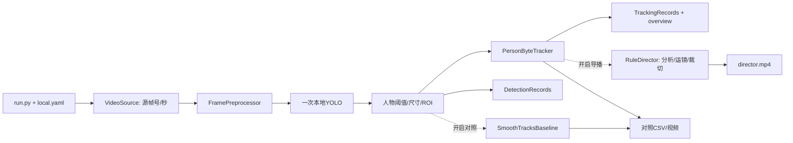

# Windows 项目结构与数据流

文件作用：说明当前真实目录、模块职责和数据格式；入口/接口变化时与 README、新人交接和验收报告同步更新。

## 当前结构

```text
project/
├── run.py                         统一运行/诊断入口
├── README.md                      最简启动与结果查看
├── NEWCOMER_HANDOFF.md             安装、命令、概念与排错
├── PROJECT_STRUCTURE.md            本文
├── AGENT_DEVELOPMENT_RULES.md       当前工程规范
├── STAGE1_WINDOWS_TO_TCN_PLAN.md    当前G2执行与验收边界
├── STAGE_PROGRESS.md / CHANGELOG.md
├── requirements-windows.txt / requirements-windows.lock.txt
├── pytest.ini / .gitignore
├── configs/local.example.yaml      日常唯一模板，复制为忽略的local.yaml
├── basketball/
│   ├── config.py / contracts.py    配置、源帧/观测契约
│   ├── sources.py                  顺序读帧、源帧号/源秒
│   ├── preprocessing.py            独立NPZ/remap；不含设备采集
│   ├── detector.py                 本地YOLO与真实类别映射
│   ├── detection_policy.py         阈值/尺寸/凸多边形ROI
│   ├── tracker.py                  ByteTrack、原框/滤波框、时间/镜头重置
│   ├── records.py                  检测JSONL与跟踪QC CSV/JSONL
│   ├── outputs.py / rendering.py   视频/全幅绘制/纯裁切/完整解码
│   ├── diagnostics.py              环境与Windows相机诊断
│   ├── pipeline.py                 组织主循环、可选输出及资源释放
│   ├── director.py                 可选纯规则导播，默认关闭
│   ├── baseline.py                 可选旧距离关联，默认关闭
│   └── rules/analysis.py,motion.py  从原算法提取的实际调用闭包
├── tests/                          组件、真实模型与无旧源码导出
│   └── fixtures/g2_before_refactor.json  旧代码先生成的180帧合成期望值
└── docs/                           当前验收、QC、来源、方案及历史验收
```

`camera_150/`、旧RTSP客户端、旧根入口、6份历史阶段示例配置和依赖Git/旧源码的硬件兼容测试移出新分支；原工程仍在历史分支。旧本地 YAML 不自动改写，`.venv`、`best_sac`、`video`、`runs` 等个人内容保留并忽略；data/models是推荐位置，不要求输入必须搬到那里。

清理范围为2887个旧Git路径（含原先稀疏隐藏的文件），磁盘实际删除73个旧文件和19个派生缓存。现存标定文件先作同哈希备份；清单、57项回归、1818帧同参数实测及无Git导出的48帧证据见 [Windows验收报告](docs/G2_WINDOWS_ACCEPTANCE_REPORT.md)，当前等待用户验收。

## 调用与数据流



根入口调用 `config.load_config`，再运行 `pipeline.run_pipeline`。环境/相机检查走 `diagnostics`，不加载检测模型。`director`、`baseline` 和 `rules` 仅开启时导入；关闭后连初始化与相应空文件都不生成。主 ByteTrack 不使用旧基线再次关联或编号。

`VideoFrame` 携带BGR、源帧号、时间及来源；`Detection` 携带实际类别编号、置信度、全幅xyxy、空间声明和observed；`TrackedPerson` 另含临时ID、段号、关联阶段与滤波框。原始检测与估计坐标分列，源帧/秒跳过片头不归零。`none`为raw_full_frame_px，already/calibration为undistorted_full_frame_px，后者声明不等于几何误差已验收。

## 配置与数据

YAML为 `windows_run_config_v1`，分 input/model/detection/tracking/director/baseline/output；CLI覆盖YAML，路径分别按调用目录/YAML目录解析，实际参数写入summary。旧平面配置显式拒绝并给迁移说明。
运行总报告使用 `windows_run_v1`；检测继续 `g1_detections_v1`，QC继续 `g2_tracking_qc_v1`，不静默改字段含义或重写旧产物。CSV一行一次确认匹配；JSONL一行一个处理帧，lost不伪造位置；球关闭为false/null。
默认文件见README，导播/对照关闭时文件不存在，summary明确标注开关。源FPS用于输出容器与缓冲换算，不等于CPU处理吞吐；输出无音轨。模型、配置、源哈希及运行目录见验收报告。

## 测试与维护

`test_frozen_regression.py` 比较冻结前后的ID/框/段/规则状态、裁切和编码前像素；`test_tracker.py` 覆盖高低关联、索引、时序和重置；组件/策略测试覆盖读写和配置；`test_standalone.py` 检查导出、惰性导入、失败释放；真实模型测试覆盖两种模式与可选开关。
不再要求Windows测试导入历史源码或执行git show。历史硬件测试留在G2基线；用户数据不进入fixtures。独立工程验收前不调跟踪参数，测试通过不表示质量达标；没有研究/训练/单应性目录。
