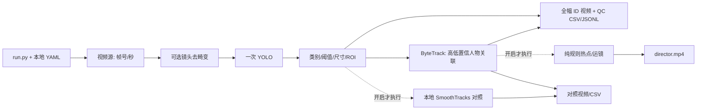

# G2 Windows 独立工程重构方案与执行记录

文件作用：保留重构前提交的方案，并记录用户授权和实施差异；最终结构、命令与证据以 README、PROJECT_STRUCTURE 和 [独立工程验收报告](G2_WINDOWS_ACCEPTANCE_REPORT.md) 为准。

## 最新执行状态

用户收到方案后要求“把多余的文件删了”，据此执行清理及保持工程可运行所需的提取与回归。Windows 工程已实施，等待独立工程验收；尚未授权进入参数优化。

实际继续使用已有干净分支 `windows/g2-standalone` 和 `D:\0basketball\project`，未另建工作树，方便用户沿用原路径。历史引用保持不变，个人环境/模型/视频/旧结果保留。按清单排除 2887 个旧 Git 路径，实际删除 73 个旧文件和19个派生缓存；现存标定文件先作同哈希备份。统一 `run.py` 与 `basketball/`，导播和旧对照默认关闭。下文为实施前方案，所述“待确认”“确认后”“优先独立工作树”等条件描述仅保留方案历史，不代表仍需重复审批。

## 1. 本次交付与执行边界

- 原方案阶段只完成源码审查和方案交付；用户随后要求清理，当前已实施，详见上方执行记录。
- 审查基线：`g2/bytetrack-person@cc87e85b69ddabab7664769822c431bb65ba07f4`。新建 `windows/g2-standalone`，本次仅提交文档；原 G2 分支不移动。
- 按用户最新任务，当前工程只支持 Windows；旧规范中“同一开发树必须兼容 RK3588、不得移出旧模块”的要求，在本任务中由“历史分支保留，新 Windows 分支独立”替代。其余解释、隔离环境、测试、隐私和验收规范继续执行。
- 顺序固定：**确认方案 → 回归基线 → 独立工程重构与实测 → 用户验收独立工程 → 检测/ByteTrack 单变量实验 → 必要时评估 ReID**。后两项不包含在本次重构实施授权中。
- 始终属于 G2。不实施 G3 数据集/通用离线重放、Homography、TCN、SAC，也不启用尚无模型的篮球检测。

## 2. 已有功能、实际依赖和不适合之处

已检查 Windows 包全部 15 个模块、3 个根目录入口/诊断脚本、5 个测试文件、6 份示例配置、依赖清单，以及 G0/G1/G2 验收、检测 schema 和跟踪 QC 文档。重点阅读旧 `single_rknn_base.py`、`predict1_weighted.py`、`predict1_director.py`、`director_game_policy.py` 和旧网络入口的运行链；对拟排除的设备、检录、技术台和客户端源码核查模块职责、入口与导入关系。第三方虚拟环境源码、人脸资料和运行资产不属于迁移源码，不将它们加载为项目程序。

| 位置 / 类或函数 | 原作用与核实的问题 | 处理方案 |
|---|---|---|
| `run_windows.py` → `windows_pipeline/run.py: main/run` | 现有物理主入口已经统一；内部以配置区分 G0/G1/G2，仍有旧阶段标签 | 改为根 `run.py`；日常只区分 `track` / `detect`，不要求用户选择历史关卡 |
| `preprocessing.py: FramePreprocessor` | 顶层导入旧 base 的标定加载器；即便 `none/already` 也加载旧目录 | 将 NPZ 解析与 remap 所需纯逻辑放进本地预处理模块；保持三种模式和尺寸检查 |
| `director_adapter.py: LegacyDirector` | 导入旧 base、技术台策略、热点和运镜模块 | 提取纯规则为可选模块，去掉技术台策略和旧目录 import；关闭时不导入、不构造 |
| `rendering.py` | 四个纯渲染函数已提取，但仍导入旧 `box_rect_to_pixels` | 需要的坐标工具本地化；全幅绘制可在导播关闭时独立工作 |
| `tracker.py: SmoothTracksBaseline` | 旧对照仍延迟导入 `single_rknn_base` | 仅提取纯距离关联到本地 `baseline.py`；与 ByteTrack 分开，默认关闭 |
| `windows_pipeline/run.py: run` | 总是构造导播；G2 总是构造旧对照、写三路视频 | 按开关创建可选分支及其文件；默认只运行检测跟踪主链 |
| `detector.py` / `tracker.py` | 已有真实类别映射、单次 YOLO、高低置信关联、源时间/段落重置和原框/滤波框区分 | 保留这些有效行为；重构阶段不调检测或跟踪参数 |
| `test_legacy_regression.py` | 测试调用 `git show` 并导入旧目录，解压无 `.git` 的 Windows 工程无法完整测试 | 先在旧代码上建立可审查的输入/期望结果，再迁移为独立回归夹具；旧硬件兼容测试留在历史分支 |
| `__init__.py` / `pytest.ini` 等说明 | 个别头注释仍写“无 ByteTrack”或“只测 G0/G1” | 按最终功能修正，检查所有入口及库模块的说明 |

当前主链实际是：顺序读帧 → 可选镜头去畸变 → 一次 YOLO → 人物筛选/高低候选 → ByteTrack → 记录与绘图；原导播与 SmoothTracks 对照现在与它绑定。新方案只解除工程绑定，第一轮不改变关联算法。

## 3. 分支与资产保护办法

| 历史位置 | 保留用途 |
|---|---|
| `origin/main@5bd9c5a437536706f51106a5e86fbb2a7ec46906` | 原 RK3588 上游版本 |
| `g0/windows-migration@406b64c` | G0 迁移成果 |
| `g1/person-detection-ball-slot@7f6b9cf` | G1 人物筛选与球接口 |
| `g2/bytetrack-person@cc87e85` | 本次重构前完整 G2 基线 |
| `windows/g2-standalone` | 本轮方案文档及确认后的 Windows 开发 |

确认后优先在独立工作树实施，实际目录由工作树工具返回并写入交接。原工作目录中的 `.venv`、`best_sac`、`video`、`runs`、本地 YAML、用户权重和私人资料保持原状；新树使用明确指定的独立解释器和本地输入路径。不会为了清理工程执行原目录的递归删除、`git clean`、强制重置或历史改写。

源码审查还核实：稀疏检出只隐藏文件，Git 树仍跟踪 `camera_150/face_env/` 下 2701 个文件、旧人脸资产、状态/日志、32 张标定图和旧客户端二进制。`.gitignore` 对这些已跟踪文件无效。

因此实施时要按**Git 路径清单**从新分支的最终版本树排除旧资产，不能只删除当前能看到的几个文件。只操作新工作树中的版本和副本，事先核对绝对路径与历史分支指向；不检出私人资产来做验证。原 Git 历史仍含上游资产，本次不清洗历史，也不宣称整个仓库历史已去除私人数据。

## 4. 保留、迁移、提取与排除清单

以下“排除”均指确认后不再出现在 Windows 新分支的最终工程树，不删除历史分支或原工作目录的个人文件。

| 类别 | 旧路径 / 内容 | 新位置及边界 |
|---|---|---|
| 迁移保留 | `windows_pipeline/contracts.py, config.py, sources.py` | `basketball/` 同名文件；保留坐标、源帧号、源时间、中文路径和配置校验 |
| 迁移保留 | `detector.py, detection_policy.py, tracker.py` | 同名新模块；仅人物 ByteTrack，篮球继续 disabled/false/null |
| 合并保留 | `detection_records.py, tracking_records.py` | `basketball/records.py`；两个已有记录器保持职责与 schema，不增通用存储抽象 |
| 迁移保留 | `outputs.py, rendering.py, diagnostics.py` | 同名新模块；预览、MP4/AVI、完整解码检查、环境/相机诊断 |
| 迁移修改 | `windows_pipeline/run.py` | `basketball/pipeline.py`；只负责组织流程与资源释放，不把算法堆入主循环 |
| 提取保留 | base 的 `SingleCameraCalib/load_single_camera_calib` 及 remap 所需逻辑 | `basketball/preprocessing.py`；不带 RKNN、V4L2、终端轮询、OpenCL 全局副作用；不提供新的标定采集工具 |
| 提取保留 | `LegacyDirector`、热点分析、运镜状态机、必要渲染工具 | `basketball/director.py` + `rules/analysis.py, motion.py`；默认关闭，仅迁移实际调用的纯规则及常量；不带 `predict1_yolo` 绘图兜底 |
| 提取保留 | base 的 `SmoothTracks` 及必要数据转换 | `basketball/baseline.py`；默认关闭，仅作旧关联对照，不再作为隐含主流程或给 ByteTrack 二次编号 |
| 整理替换 | `run_windows.py, check_windows_environment.py, check_windows_camera.py` | 根 `run.py` 统一提供运行/诊断参数；删除重复旧根入口，新文档给出迁移命令 |
| 整理替换 | 6 份分散的 `*.example.yaml` | 一份 `configs/local.example.yaml`，含输入/模型/检测/跟踪/可选项；本地副本 `local.yaml` 不提交；旧配置不静默误读 |
| 保留更新 | `tests/`、依赖锁文件、根目录规范与交接、`docs/` | 保留有效行为覆盖；旧验收报告标注历史证据，另交付 Windows 独立工程验收报告 |
| 排除 | `camera_150/camera_movement_modified/` 剩余内容 | RKNN 检测/录制/推流入口、音频链、技术台导播策略、旧备份和日志都不进入新树 |
| 排除 | `camera_150/techtable_v2/`、`camera150_techtable_v3_patch/`、`apply_camera150_workflow_patch.py`、`start_all_techtable.py`、`stop_all_techtable.py` | 不迁移技术台、LCD、HTTP 比分状态、人脸启动流程和补丁工具 |
| 排除 | `face_checkin_lbph*.py`、`face_env/`、`face_checkin/`、`runtime/` | 不迁移检录、虚拟环境、照片/身份及运行状态 |
| 排除 | `calib_usb3_camera_150.py`、`record*_usb3_camera_150.py`、`check_rtsp_av.py`、`mediamtx_rk3588.yml`、`model/`、`calib_usb3_images/`、旧 NPZ/缓存 | 不带 Linux 采集/标定工具、RKNN 权重、原始资产；用户自己的 NPZ 可在本地显式指定 |
| 排除 | `windows_camera_150_client/` 全部 | 名称虽带 Windows，实际是 RTSP/音频/比分观看客户端，当前检测跟踪不需要 |

完成提取后，Windows 分支不再保留 `camera_150/`。源码出处、原函数对应、上游提交与第三方许可证说明写入文档；不复制 Ultralytics/ByteTrack 第三方实现到项目中。

## 5. 目标目录与数据流（尚未实施）

```text
project/
├── run.py                          # 唯一日常运行和诊断入口
├── README.md                       # 开头即启动命令、输入准备、结果查看
├── NEWCOMER_HANDOFF.md
├── PROJECT_STRUCTURE.md
├── AGENT_DEVELOPMENT_RULES.md / STAGE1_WINDOWS_TO_TCN_PLAN.md
├── STAGE_PROGRESS.md / CHANGELOG.md
├── requirements-windows.txt / requirements-windows.lock.txt
├── pytest.ini / .gitignore
├── configs/local.example.yaml      # 复制为 local.yaml 后修改；本地文件忽略
├── basketball/
│   ├── __init__.py
│   ├── config.py / contracts.py / sources.py
│   ├── preprocessing.py / detector.py / detection_policy.py
│   ├── tracker.py / records.py
│   ├── rendering.py / outputs.py / diagnostics.py
│   ├── pipeline.py
│   ├── director.py                  # 可选规则导播适配
│   ├── baseline.py                  # 可选旧关联对照
│   └── rules/__init__.py / analysis.py / motion.py
├── tests/                          # 组件、固定输入回归、独立导出、真实模型集成
│   └── fixtures/                   # 小型合成输入及期望结果，不含用户录像/权重
└── docs/                           # 本方案、独立工程验收、QC、历史报告和来源说明

# 本地忽略：.venv/、models/、data/、video/、runs/、configs/local.yaml
```

`rules` 分为分析与运镜，是因为现有两份纯算法较长、状态职责不同；不拆成大量小类或逐函数文件。不增加插件系统、服务层、跨平台后端工厂或训练框架。



算法解释：YOLO 对每帧提出“哪里像人”的框及置信度。ByteTrack 先预测已有轨迹的位置，再按重叠/代价匹配高置信框；尚未匹配的活动轨迹再尝试低置信框。低置信框只能帮助续接，不能单独创建新轨迹。新框可能先待确认，丢失轨迹暂留缓冲。Track ID 是当前运行与片段内的临时编号，不是球员身份；原规则则根据人物密集区域平滑移动裁切框，属于可选输出。

## 6. 配置、入口和用户看到的结果

实施后采用一份可注释的嵌套 YAML，字段按输入、模型、检测、跟踪、导播、对照、输出分组。配置版本为 `windows_run_config_v1`；相对路径以 YAML 所在目录解析，CLI 覆盖 YAML，最终生效值写入 summary。未知字段、旧版本/旧阶段配置、输入缺失均明确报错并给迁移说明，不默默退回默认值。

日常默认 `track`：每帧一次 YOLO、人物 ByteTrack、全幅 ID 视频、QC CSV/JSONL、检测审计和 summary/log；`detect` 只做检测审计与全幅框，不假造 ID。导播和旧关联对照各有独立开关，默认均关闭。保留文件输入与 Windows 相机后端；本轮固定验收优先离线视频，不承诺实时相机吞吐。

下面是**计划实现的命令，不是当前可用命令**：

```powershell
Copy-Item .\configs\local.example.yaml .\configs\local.yaml
# 编辑 local.yaml，填入自己的 source 和 weights。
.\.venv\Scripts\python.exe -X utf8 .\run.py --config .\configs\local.yaml
# 快速测试：只处理所选起点后的 48 帧；不能代替质量验收。
.\.venv\Scripts\python.exe -X utf8 .\run.py --config .\configs\local.yaml --max-frames 48
.\.venv\Scripts\python.exe -X utf8 .\run.py --check-env --config .\configs\local.yaml
.\.venv\Scripts\python.exe -X utf8 .\run.py --check-camera --camera 0 --backend dshow
.\.venv\Scripts\python.exe -X utf8 -m pytest -q
```

本机实测输入沿用用户批准的桌面 `best.pt`，类别 `{0: 'person'}`，SHA-256 `d68486dcc883388d1d822a9ab67d9d6c9cd5c6dccf653c63242ecc9e39863db9`。室内视频从现有 `configs/g2.indoor.local.yaml` 读取准确路径，跳过前 30 秒；视频 SHA-256 `4023326edd7e0fa768494356c659cd6f46478ad8d8df844ab49fbe919ecc3816`。不重新手输含不可见字符的长文件名，不读取 `best_sac`。

重构回归参数保持：CPU、imgsz=640、NMS IoU=.7、人物高/低阈值 .35/.10、建轨 .35、match_thresh=.8、fuse_score=true、buffer=30（30 FPS 等效约 1 秒）、ROI y=.66–.97、间隔重置 .5 秒、转场阈值 .65、每帧推理、篮球关闭。导播/对照开启时保持旧规则和 `.65/180/15` 对照参数。源帧/时间不从零重新编号；`none` 仍是 `raw_full_frame_px`，不冒称已完成几何矫正。

每次写唯一 `runs/<运行标识>/`：默认 `overview.mp4`、`bytetrack_qc.csv`、`tracking_audit.jsonl`、`detections.jsonl`、`summary.json`、`run.log`；开启导播才有 `director.mp4`，开启对照才有 `tracking_comparison.mp4` 与 `smoothtracks_qc.csv`。关闭分支的报告字段明确为未启用，不生成空文件冒充完成。已有检测/QC schema 保持；新增总报告使用 `windows_run_v1`，映射表写入文档，不重写历史报告。

可直接运行的 Python 文件头部必须写用途、PowerShell 命令、必备输入、快速测试、输出和常见错误。只有根 `run.py` 是日常程序入口；库模块注明调用入口、输入输出与针对性 `pytest` 命令，测试文件注明 `python -m pytest` 调用，不编造直接执行库模块的命令。注释重点说明阈值边界、关联阶段、ID 会话、时间来源、像素空间及缺失值。

## 7. 必须先于重构建立的回归基线

1. **先保存旧版本证据**：记录基线提交、依赖/解释器、真实模型/视频哈希、最终配置和命令；运行现有测试。此前 `53 passed in 7.44s` 仅是历史结果，本轮方案没有重跑，不填作新通过结果。
2. **再补必要的行为回归**：固定类别映射和候选顺序、高低置信边界及原候选索引、ROI 边界、原框与滤波框、源时间/跳段/重复帧、无球缺失语义、输出失败与资源关闭。先在原代码运行通过，再修改包路径和结构。
3. **固定输入夹具**：保存小型合成关联序列及原程序期望值；保留 180 帧规则序列，记录其状态、裁切矩形和解码前图像结果。仅保留需要的纯算法覆盖，不把 RKNN 构造器/旧脚本导入兼容当成 Windows 新需求。
4. **真实模型对照基线**：固定室内 30 秒至结束的 1818 帧及短外景回归；按原运行生成检测/跟踪记录，保存候选的原顺序、源帧/PTS、库版本与配置。真实缓存、截图和权重留在被忽略的本地证据目录；不把回归夹具扩展成 G3 数据产品。
5. **重构后比较**：相同输入与参数下核对检测候选、每帧确认轨迹/ID/段号/阶段、重置事件、记录字段与计数；框数、ID、离散状态需一致，浮点采用预先说明的容差（默认绝对误差 1e-5，坐标像素；若依赖/平台导致差异须解释并重新评审）。导播与对照开启时额外比较规则状态、裁切矩形和编码前画面；MP4 字节哈希不作为跨编码环境的一般回归标准。

出现差异先定位导入、排序、取整、时间或资源行为；不能借重构顺手调参掩盖差异。默认关闭可选输出会减少视频数量，这属于明示的产品行为变化；核心跟踪记录必须在开/关组合下保持一致。

## 8. 独立工程验收条件与证据

| 验收项 | 实施后必须提供的证据 |
|---|---|
| 历史保留 | 旧分支提交指向核对；原目录个人文件未改；新分支 Git 树排除清单 |
| 真正独立 | 导出一个无 `camera_150/`、无旧客户端、**无 `.git`** 的干净工程，在目录外用明确的独立解释器启动、运行测试和真实模型；无需原工作目录源码/历史对象 |
| 无旧运行依赖 | 静态扫描 import/路径注入；新进程实际运行后检查已导入模块，禁止旧源码、RKNN、技术台、Linux 音频等；导播/对照关闭时也不加载其模块 |
| 入口和配置 | `run.py --help`、日常配置、48 帧快速验证、detect/track、中文/空格/跨工作目录路径；错误配置及缺模型明确失败 |
| 功能回归 | 上述固定输入和真实记录比较报告；不以测试总数保持 53 作为目标，不因删除旧测试而丢失有效算法覆盖 |
| 真实长片段 | 同权重/视频/起点处理 1818 帧；默认模式、导播/对照开关验证；每路已启用视频关闭后完整解码，记录逐行独立检查 |
| 输出可读性 | 每种模式列明文件名、行数、分辨率、FPS、源时间；球始终关闭且位置 null；lost 只记录状态，不输出假观测 |
| 人工回归 | 查看篮下 30–32 秒、持球者 59–62 秒、横向移动 73–77 秒和场边 85–96 秒的同帧/连续视频；确认没有重构引入的新回归，已有失败保留可见 |
| 运行说明与交接 | 所有 Python 文件用途/运行或调用说明审查；README、新人交接、结构/数据流、进度、变更、来源/依赖说明和独立工程验收报告一致 |

验收报告将同时列“本轮实测 / 历史证据 / 合成测试 / 未测试”。CPU 为必测；CUDA、长时相机与其他视频不未经实测填写通过。独立工程自测完成后停止，提交用户验收；**测试通过或视频能播放不等于跟踪质量达标**。

## 9. 独立工程获验收后，才执行的质量实验安排

当前证据：篮下有同人重复框；源帧 1451 / 60.3396 秒持球者有约 .371 的检测，却没有确认 ByteTrack ID，P218 在 lost 中，随后成为 P425；场边 P792 曾连续 229 帧低置信续接。640/1280 的既有试验只有 6 张固定原图，960 尚未测，不能据此认定更大尺寸或新算法更好。

1. 固定同一视频、模型、30 秒起点、连续帧范围和依赖，顺序解码；以四类失败窗口和一个连续全片检查为评估范围。人工按画面给可辨认目标临时真值编号，记录可见/遮挡/无法判断；不强行给遮挡中不确定身份打标签。保留横向移动正例作为回归检查。
2. **检测实验**：先只改变 imgsz=640/960/1280，其他阈值/NMS/ROI 固定；分别保存各尺寸同帧候选及顺序、耗时、参数/哈希和原图。再单独比较 NMS 等因素。评估漏检、同人重复框、误检与场边混入；不凭框总数选择方案。
3. **真实球场 ROI**：在完整输入画面标实际可见场地多边形，以人物底部中心测试；现有凸多边形能力可以复用，不需 Homography。单独比较 ROI，检查远端和边线球员误排/脚点抖动；原 y=.66 矩形仍作为对照，记录按视频选择区域的理由。
4. **跟踪实验**：冻结同一批检测、顺序、置信度及时间，改变跟踪参数时不重跑 YOLO。逐项比较建轨门槛、第一阶段代价门槛、分数融合、丢失缓冲。记录匹配前预测框、IoU/融合代价、匹配阶段、未匹配/待确认/移除事件，专门还原 P218→P425；不预先将原因归结为漏检。
5. 当前 Ultralytics 8.3.225 的低置信第二阶段代价阈值为源码固定 `.5`，待确认关联为 `.7`；`match_thresh=.8` 只控制第一阶段，不能声称一个 YAML 值改变全部关联阶段。先增加可关闭的诊断记录；若实验确需调整库内阈值，再解释实施方式和维护成本，不暗改 site-packages。
6. 人工核查相同对象的连续可见段，分别统计换号、断裂、重复轨迹、错误续接和场边持续跟踪；报告样本范围、遮挡不确定项、每组参数及耗时。无足够身份真值不报告 IDF1/MOTA；不以最大 ID、不同 ID 数或输出行数判优劣。
7. “最多十名有效场上目标”只可作为另行说明的后处理软筛选，默认关闭；保留原始轨迹/ID与筛选原因，不能复用旧 ID、压成 1～10 或声称识别了真实球员身份。
8. 检测与 ByteTrack 调整后，交叉片段仍有人工确认的频繁换号，才提出 **BoT-SORT + ReID** 实验。ReID 用外观特征辅助区分相近运动轨迹，相似球衣和遮挡仍会失败。先说明外观权重来源/许可证与额外依赖，固定已选检测和片段，比较同一批人工身份案例及耗时；没有实验不宣布胜出，也不自动更换默认算法。

## 10. 本次方案交付记录及确认范围

- 本轮仅新建 Windows 分支并更新文档；未修改 Python/YAML/依赖，未安装环境、运行新模型试验、删除资产或推送分支。
- 本轮验证为源码/依赖/历史证据审查、文档链接与 Git 差异检查；自动化和真实模型测试留到确认后的回归基线步骤，不能把旧 53 项结果算成本轮通过。
- 文档检查实际结果：9 份 Markdown 中 40 个本地链接均存在；`git diff --check` 通过，Python/YAML/依赖/pytest 配置与 `cc87e85` 无差异；G0/G1/G2 和上游历史指向核对不变。
- 本次同步 README、NEWCOMER_HANDOFF、PROJECT_STRUCTURE、STAGE_PROGRESS、CHANGELOG、G2_ACCEPTANCE_REPORT，以及两份规范的当前任务优先说明。
- 请确认的是第 3～8 节的 **Windows 独立化实施方案**，包括仅从新分支排除旧工程、提取可选导播/对照、统一入口/配置与回归验收。确认后先实施并提交独立工程验收，等待再次确认；不据此直接开始第 9 节调参或 ReID。
